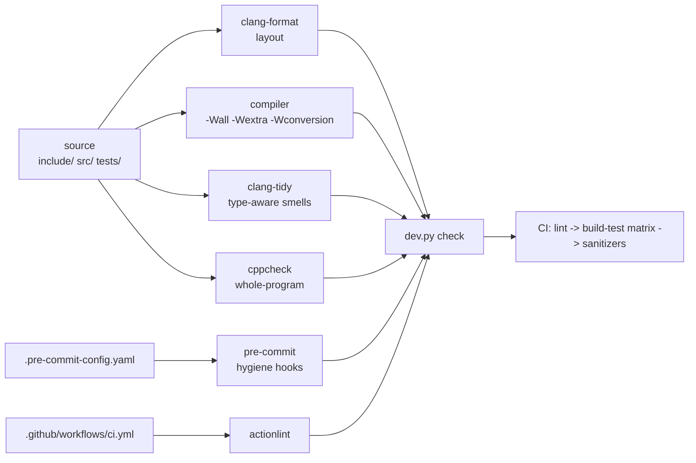

# Tooling map

How the tools in this repo divide the work, how they fit together, and how they
are kept honest. `AGENTS.md` has the commands; this file has the reasoning, so a
future change to a tool config can be judged against its purpose.

## The pipeline

`python3 tools/dev.py check` runs format-check, clang-tidy, cppcheck, build and
test in that order, cheapest first, so a formatting slip fails in a second
instead of after a three-OS build.

## Division of labour

Each tool owns one class of problem. Overlap is the enemy: a finding that two
tools report twice is a finding people learn to ignore.

| Tool | Owns | Deliberately does NOT |
| --- | --- | --- |
| compiler | type errors, implicit conversions, shadowing, format strings | whole-program dataflow |
| clang-format | whitespace, wrapping, include grouping | anything semantic |
| clang-tidy | type-aware smells: `bugprone-*`, `clang-analyzer-*`, `performance-*`, curated `modernize-*` / `readability-*` | layout, naming opinion |
| cppcheck | uninitialised data, dead code, portability (warning/performance/portability groups) | style and semantic smells - clang-tidy's, because it is pinned |
| pre-commit | trailing whitespace, EOF newline, YAML/JSON validity, large files, committing to `main` | compilation |
| actionlint | workflow syntax and expression types | C++ |
| libFuzzer + ASan/UBSan | crashes, UB and NaNs on adversarial input | systematic coverage |
| CTest + Catch2 | behaviour, invariants, golden regression | performance |
| `bench/world_bench.cpp` | throughput before/after a change | correctness |

## Version pinning

Two tools are pinned because their output is a *contract* rather than a
diagnostic:

| Tool | Pinned where | Why |
| --- | --- | --- |
| clang-format (major 23) | `tools/dev.py::PINNED_CLANG_FORMAT_MAJOR`, `.pre-commit-config.yaml` `rev` | a different major reformats the tree, so "format check" would fail for whoever has the other version |
| clang-tidy (major 23) | `tools/dev.py::PINNED_CLANG_TIDY_MAJOR` | the check set and its findings move between majors |

cppcheck is deliberately **not** pinned: the project publishes no Linux binary
for its current release, and building it in CI would cost more than it returns.
Instead its check set is restricted to `warning`, `performance` and
`portability` - the groups whose findings are stable across versions. CI's
cppcheck 2.13 reported a `style` finding that local 2.22 does not, and style is
clang-tidy's job anyway.

`python3 tools/dev.py doctor` reports the local versions, the pinned versions,
and treats a mismatch as a problem. It also resolves keg-only Homebrew LLVM
(`/opt/homebrew/opt/llvm/bin`) and versioned binaries (`clang-format-23`), and
honours `CLANG_FORMAT` / `CLANG_TIDY` overrides for CI.

## Deliberate suppressions

Every suppression names the check and the reason, in the file that owns the
flag. Suppressions are not silent.

| Where | Check | Reason |
| --- | --- | --- |
| `tools/dev.py` (cppcheck) | `passedByValue` | fires on `Vec2`/`Vec3`/`Quat` operator overloads; these are 16-byte trivially copyable aggregates, and by-value is the faster ABI |
| `tools/dev.py` (cppcheck) | `knownConditionTrueFalse` for `tests/*` | unit tests assert a pure function's output for constant input; that is the point of the test |
| `tools/dev.py` (cppcheck) | `unusedFunction` | a static library's entry points look unused per translation unit |
| `.clang-tidy` | `bugprone-easily-swappable-parameters`, `bugprone-narrowing-conversions` | duplicate compiler warnings that are already errors |

cppcheck analyses **translation units only**. Analysing a header on its own
means nothing in it has a reader, which is how it invents `unusedStructMember`
for every struct in the public API; headers are covered through the `.cpp` files
that include them.

## Rules the gate enforces

- **Warnings are errors in CI, not locally** (`POOL_WARNINGS_AS_ERRORS`,
  `tidy --strict`). A newer compiler on a developer's machine must not brick
  their build; CI is where the line is drawn.
- **The compile database is the interface.** clang-tidy and any editor tooling
  read `build/<preset>/compile_commands.json`, which CMake writes on configure.
  `dev.py tidy` fails with an instruction to configure if it is missing.
- **FetchContent sources are not linted.** Third-party code pulled into
  `build/_deps` is excluded from cppcheck; its style is not this repo's problem.
- **The physics core stays dependency-free**, which is what lets every physics
  test run in milliseconds with no display, no assets and no network.

## Adding a tool

Ask three questions before adding one:

1. **Which class of finding is unowned?** If an existing tool reports it, improve
   that tool's config instead.
2. **What does it cost in CI seconds?** A tool that needs a full build on three
   platforms is not worth a style opinion.
3. **Where does it get suppressed, and with what reason?** A tool whose findings
   are routinely ignored is worse than no tool.

Then wire it in one place only - `tools/dev.py` for a local step, and the
matching CI job - so local and CI cannot drift.

## Related

- `docs/research/dev-toolchain-and-physics.md` - the primary sources behind the
  coefficients, the pinned versions and the rendering approach.
- `docs/adr/` - the decisions this map implements.
- `CONTRIBUTING.md` - the human-facing workflow.
